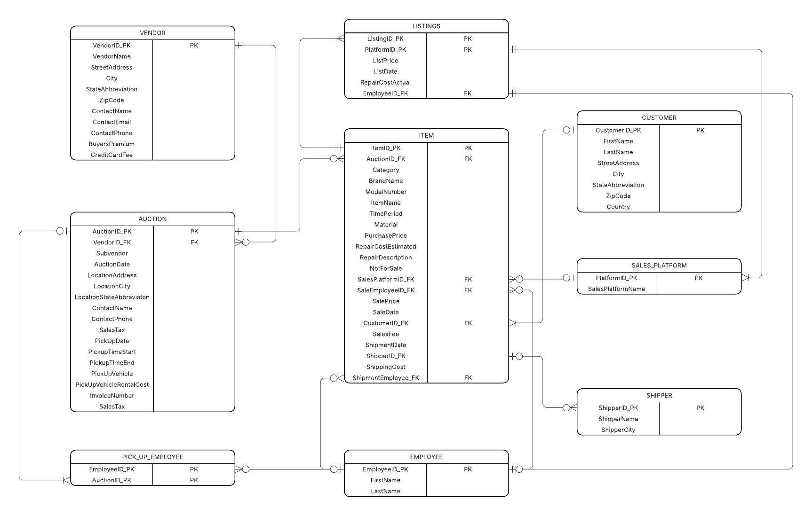

# Antique Dealer Inventory & Sales Database

A relational database application built in **Microsoft Access** for a small antique dealer. It replaces a large, hard-to-manage spreadsheet with a structured system that tracks every item from the auction where it was bought, through refurbishment and listing, to its sale and shipment to the customer.

*Semester project for CISS 143: Database Design and Implementation, Lorain County Community College (Fall 2025)*

---

## 📌 The Business Problem

The dealer buys antiques at auctions, picks them up, repairs them, lists them on third-party platforms such as Facebook Marketplace, then sells and ships them. All of this lived in one large spreadsheet, which made it hard to answer basic questions:

- Which auctions still have items waiting to be picked up?
- Which items are ready to list, and which are listed but unsold?
- What did each item cost (purchase price, buyer's premium, repairs, fees, shipping) compared with what it sold for?
- Which employees handled pickups, sales, and shipments?

## 🗺️ Entity Relationship Diagram



The database has **9 related tables**, designed with primary and foreign keys and normalized to reduce duplicate data:

| Table | What it stores |
|---|---|
| **VENDOR** | Auction houses: contact info, buyer's premium, credit card fees |
| **AUCTION** | Each auction attended: date, location, pickup window, vehicle rental cost, invoice, sales tax |
| **ITEM** | Each antique: category, brand, model, time period, material, purchase price, estimated vs. actual repair cost, sale and shipment details |
| **LISTINGS** | Items listed for sale: platform, list date, list price, employee |
| **SALES_PLATFORM** | Third-party platforms where items are listed |
| **CUSTOMER** | Buyers and shipping addresses |
| **SHIPPER** | Shipping carriers |
| **EMPLOYEE** | Staff members |
| **PICK_UP_EMPLOYEE** | Junction table linking employees to the auctions they picked up (many-to-many) |

## 🔄 Workflow the Database Supports

1. **Auction won:** record the auction and the items purchased
2. **Picked up:** assign employees and mark auction items as collected
3. **Listed:** list ready items on a sales platform with a price
4. **Sold:** record the sale price, platform fee, customer, and employee
5. **Shipped:** record the carrier, shipping cost, and shipping employee

Each step has its own **data entry form**, opened from a central **menu dashboard** that launches automatically at startup through an **AutoExec macro**.

## 🔍 Example Query

This query finds every item that has not yet sold and is not marked "Not for Sale," the dealer's live inventory:

```sql
SELECT ITEM.ItemID_PK, ITEM.Category, ITEM.BrandName, ITEM.ModelNumber,
       ITEM.ItemName, ITEM.TimePeriod, ITEM.Material, ITEM.PurchasePrice
FROM ITEM
WHERE ITEM.SaleDate IS NULL
  AND ITEM.NotForSale = False;
```

Other saved queries include:
- **Auctions to Be Picked Up:** auctions with items still waiting to be collected
- **Items to Be Listed:** inventory that is ready but not yet listed
- **Sold Items by Date:** sales history, joined with item and auction data
- **All Items per Auction:** what was bought at each auction
- **Facebook Marketplace Listings:** items listed on a specific platform
- **Shipments:** joins of items, customers, and shippers for fulfillment

## 🛠️ Skills Demonstrated

- Relational database design and normalization
- Entity relationship modeling (ERDPlus)
- Primary and foreign keys, one-to-many and many-to-many relationships
- SQL queries with multi-table `INNER JOIN`s, filtering, and sorting
- Data entry forms with subforms, combo boxes, and list boxes
- Navigation menu and AutoExec macro automation
- Requirements gathering and documentation (project proposal)

## 📂 Files

| File | Description |
|---|---|
| `AntiqueDealerDatabase.accdb` | The Microsoft Access database (tables, queries, forms, macros) |
| `erd-diagram.png` | Entity relationship diagram |
| `Project_Proposal.pdf` | Original proposal with requirements, forms, and reports |

> **Note:** To open the `.accdb` file you need Microsoft Access (Windows). The data included is sample data.

---

**Tools:** Microsoft Access · SQL · ERDPlus
